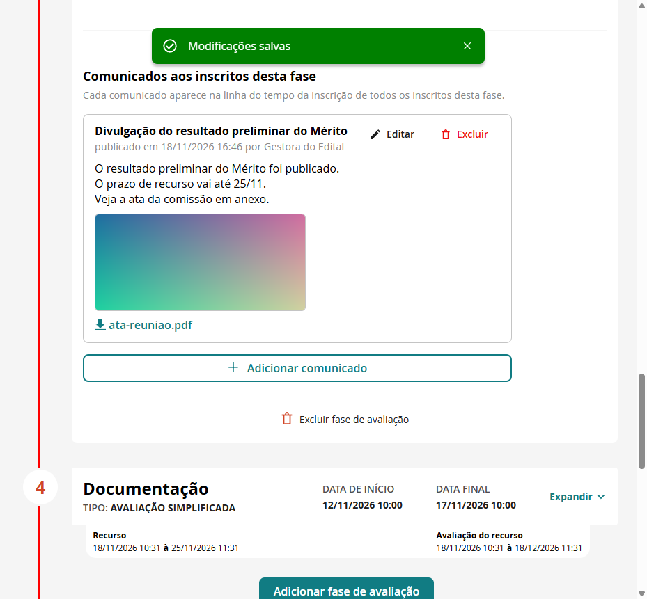
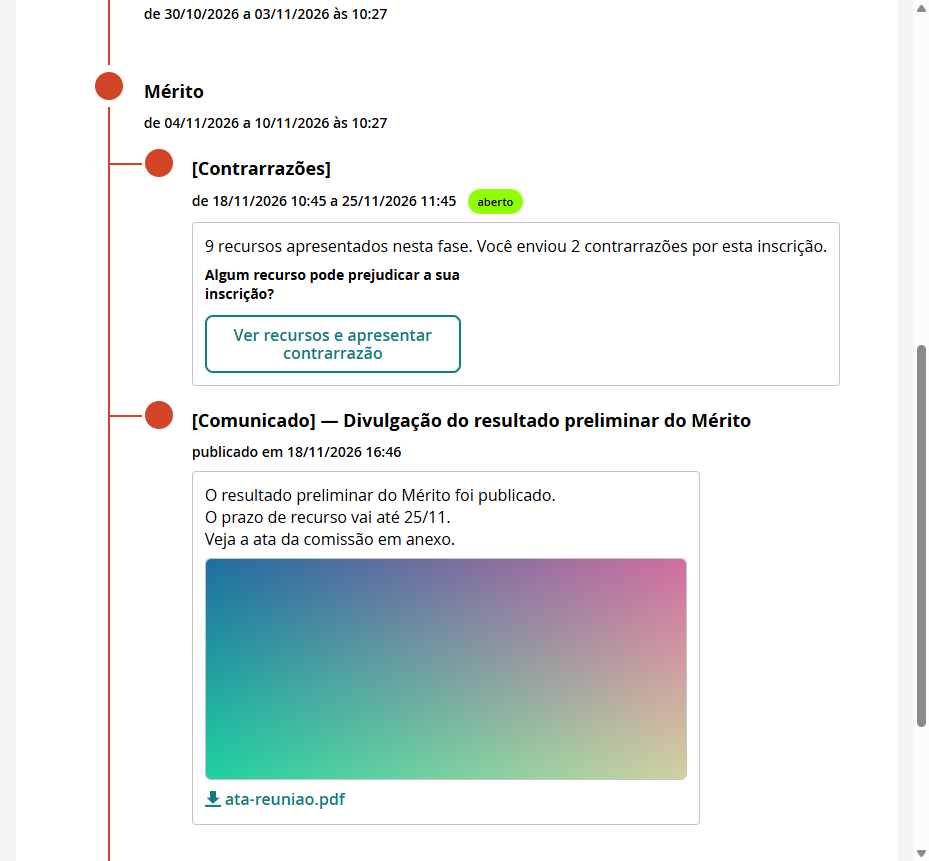

# Comunicados em Etapas — plugin para o Mapas Culturais

Plugin para o [Mapas Culturais](https://github.com/mapasculturais/mapasculturais) que permite ao gestor de um edital publicar **comunicados** (título, mensagem, imagem e anexos) em **qualquer fase**. Cada comunicado aparece na **linha do tempo da inscrição** de todos os inscritos daquela fase.

Exemplos de uso: divulgação de resultado preliminar, prorrogação de prazo, orientações sobre documentos, ata de reunião da comissão, cartaz de evento de encerramento.

Desenvolvido para o Mapa Cultural BH (Fundação Municipal de Cultura / PBH).

| Gestor escreve | Gestor acompanha | Candidato vê na linha do tempo |
|---|---|---|
|  |  |  |

## Sumário

1. [O que o plugin faz](#o-que-o-plugin-faz)
2. [Regras](#regras)
3. [Requisitos](#requisitos)
4. [Instalação](#instalação)
   - [Instalação direta (sem Docker)](#a-instalação-direta-sem-docker)
   - [Instalação com Docker (projeto base do Mapas)](#b-instalação-com-docker-projeto-base-do-mapas)
   - [Conferindo se o plugin está ativo](#conferindo-se-o-plugin-está-ativo)
   - [Configurações opcionais](#configurações-opcionais)
   - [Atualizando o plugin](#atualizando-o-plugin)
   - [Problemas comuns](#problemas-comuns)
5. [Como usar](#como-usar)
6. [Modelo de dados](#modelo-de-dados)
7. [Referência técnica](#referência-técnica)
   - [Estrutura de arquivos](#estrutura-de-arquivos)
   - [Metadado e grupos de arquivo](#metadado-e-grupos-de-arquivo)
   - [Endpoints](#endpoints)
   - [Pontos de encaixe nas telas](#pontos-de-encaixe-nas-telas)
   - [Funções da classe `Plugin`](#funções-da-classe-plugin)
   - [Componentes Vue](#componentes-vue)
8. [Atualizações do Mapas](#atualizações-do-mapas)
9. [Testes](#testes)
10. [Limitações conhecidas](#limitações-conhecidas)
11. [Desinstalação](#desinstalação)

## O que o plugin faz

### Para o gestor

Na edição da oportunidade, aba **Configuração de fases**, cada fase do edital ganha no fim a seção **Comunicados aos inscritos desta fase**. Vale para a fase de inscrições, as fases de avaliação, as fases de coleta de dados e a publicação final. Nela, o gestor:

- **publica** um comunicado com título (opcional), mensagem, **uma imagem** e **até 5 anexos**;
- vê os comunicados já publicados na fase, com data, autor, imagem e anexos;
- **edita** um comunicado: muda o texto, troca ou remove a imagem, remove anexos e acrescenta outros;
- **exclui** um comunicado, o que apaga também a imagem e os anexos.

### Para o candidato

Na linha do tempo da inscrição (*Minhas inscrições* → inscrição → aba *Acompanhamento*), cada comunicado aparece **dentro da fase a que pertence**, como um quadro **[Comunicado]**, no mesmo formato do quadro *[Recurso]* do Mapas. O quadro mostra:

- o título e a data de publicação;
- a mensagem, com as quebras de linha;
- a imagem, que abre em tamanho real ao clicar;
- os anexos, para baixar.

Os comunicados mais recentes aparecem primeiro.

## Regras

| Regra | Como funciona |
|---|---|
| Quem publica | O gestor do edital (quem tem controle sobre a oportunidade). |
| Quem vê | Todos que têm inscrição **na fase** do comunicado. Comunicados da fase de inscrições aparecem para todos os inscritos. Comunicados de uma fase posterior aparecem só para quem chegou a ela. Inscrições na lixeira não contam. |
| Fase | Cada comunicado pertence a uma fase e não muda de fase ao ser editado. As fases de avaliação contam separado da fase de coleta de dados: *Fase de inscrições* e *Habilitação* são itens diferentes da linha do tempo, mesmo que estejam na mesma oportunidade. |
| Conteúdo | Pelo menos um destes: título, mensagem, imagem ou anexo. Mensagem de até 10.000 caracteres, em texto simples (sem HTML). |
| Imagem | Uma por comunicado: JPG, PNG, GIF ou WEBP, até 10 MB. |
| Anexos | Até 5 por comunicado: PDF, imagens, documentos de texto (DOC, DOCX, ODT), planilhas (XLS, XLSX, ODS), CSV, TXT ou ZIP, até 10 MB cada. O tipo é conferido pelo **conteúdo** do arquivo, não pela extensão. |
| Privacidade | Imagens e anexos são **arquivos privados**: não ficam na pasta pública do Mapas e só são entregues pelo endpoint do plugin, que confere se quem pede é gestor ou inscrito na fase. Os comunicados também não aparecem na API pública. |

## Requisitos

- Mapas Culturais **7.8.x**, com o tema **BaseV2**. Testado na **7.8.21**.
- Acesso para editar a configuração do Mapas e reiniciar o PHP (ou os contêineres).
- Limites de envio compatíveis com o tamanho dos arquivos: `upload_max_filesize` e `post_max_size` no PHP (no projeto base, 20 MB) e `client_max_body_size` no nginx.

O plugin **não cria tabelas** e **não precisa de `db-update`**. Ele usa metadados e arquivos das entidades do próprio Mapas.

## Instalação

O plugin precisa ficar na pasta **`src/plugins/Comunicados`** do Mapas. O nome da pasta tem que ser exatamente `Comunicados`, porque é também o namespace PHP do plugin. Por isso o `git clone` abaixo informa o nome da pasta no fim.

### A) Instalação direta (sem Docker)

1. **Baixe o plugin** para a pasta de plugins do Mapas:

   ```bash
   cd /caminho/do/mapas/src/plugins
   git clone https://github.com/yanlfs08/mapas-plugin-observacao-em-etapas.git Comunicados
   ```

2. **Ative o plugin.** Abra o arquivo de configuração de plugins que a sua instalação usa (por exemplo, `config/plugins.php` ou um arquivo dentro de `config/*.d/`) e acrescente `Comunicados` à lista, **sem remover os plugins que já existem**:

   ```php
   <?php
   return [
       'plugins' => [
           'MultipleLocalAuth' => ['namespace' => 'MultipleLocalAuth'],
           // ... outros plugins já ativos
           'Comunicados' => ['namespace' => 'Comunicados'],
       ],
   ];
   ```

3. **Recompile os assets**, se a sua instalação compila os componentes com `pnpm`:

   ```bash
   cd /caminho/do/mapas/src
   pnpm install --recursive && pnpm run build
   ```

4. **Limpe o cache e reinicie o PHP:**

   ```bash
   redis-cli FLUSHALL                  # se o cache do Mapas estiver no Redis
   sudo systemctl reload php8.3-fpm    # ajuste para a versão do seu PHP-FPM
   ```

5. [Confira se o plugin está ativo](#conferindo-se-o-plugin-está-ativo).

### B) Instalação com Docker (projeto base do Mapas)

No [projeto base do Mapas](https://github.com/mapasculturais/mapasculturais-base-project), a imagem é gerada a partir de `docker/Dockerfile`, que **copia** a pasta `plugins/` e a configuração para dentro da imagem:

```dockerfile
COPY plugins /var/www/src/plugins
...
COPY docker/common/config.d /var/www/config/common.d
```

Por isso, toda instalação ou atualização do plugin exige **gerar a imagem de novo**.

1. **Baixe o plugin** para a pasta `plugins/` do projeto:

   ```bash
   cd /caminho/do/projeto-base/plugins
   git clone https://github.com/yanlfs08/mapas-plugin-observacao-em-etapas.git Comunicados
   ```

2. **Ative o plugin** em `docker/common/config.d/plugins.php`:

   ```php
   <?php
   return [
       'plugins' => [
           'MultipleLocalAuth' => ['namespace' => 'MultipleLocalAuth'],
           'SamplePlugin' => ['namespace' => 'SamplePlugin'],
           'SpamDetector',
           'Comunicados' => ['namespace' => 'Comunicados'],
       ],
   ];
   ```

3. **Gere a imagem e recrie o contêiner da aplicação:**

   ```bash
   cd /caminho/do/projeto-base
   docker compose build mapasculturais
   docker compose up -d mapasculturais
   ```

4. **Limpe o cache** (no projeto base, o Redis de cache se chama `redis`):

   ```bash
   docker compose exec redis redis-cli FLUSHALL
   ```

5. [Confira se o plugin está ativo](#conferindo-se-o-plugin-está-ativo).

> **Alternativa para desenvolvimento:** monte a pasta do plugin como volume no serviço `mapasculturais` do `docker-compose.yml` (`- ./plugins/Comunicados:/var/www/src/plugins/Comunicados`). Mudanças em PHP valem depois de limpar o cache. Mudanças em JavaScript ou CSS exigem recompilar os assets dentro do contêiner (`pnpm run build` em `/var/www/src`).

> **Backup:** as imagens e os anexos ficam na pasta de **arquivos privados** do Mapas. No projeto base, é `docker-data/private-files`, montada em `/var/www/var/private-files`. Inclua essa pasta no backup, junto com o banco.

### Conferindo se o plugin está ativo

1. **Arquivos no lugar** (no Docker, dentro do contêiner):

   ```bash
   docker compose exec mapasculturais ls /var/www/src/plugins
   # deve listar: Comunicados
   ```

2. **Metadado registrado.** A descrição das oportunidades passa a listar o metadado do plugin:

   ```bash
   curl -s http://localhost/api/opportunity/describe | grep -o '"phaseAnnouncements"' | head -1
   ```

3. **Na tela:** abra uma oportunidade, aba **Configuração de fases**, expanda uma fase e confira a seção **Comunicados aos inscritos desta fase** no fim dela.

4. **Log sem erros.** No projeto base, o log fica em `docker-data/logs/app.log`. Se a versão do Mapas estiver fora da faixa testada, aparece o aviso *"Plugin Comunicados ... foi testado com o Mapas Culturais 7.8.x"*.

### Configurações opcionais

Para mudar os limites, informe `config` na ativação do plugin:

```php
'plugins' => [
    'Comunicados' => [
        'namespace' => 'Comunicados',
        'config' => [
            'maxFileSizeMb' => 10,       // tamanho máximo de cada arquivo, em MB
            'maxAttachments' => 5,       // anexos por comunicado
            'maxTextLength' => 10000,    // caracteres da mensagem
            'imageMimeTypes' => ['image/jpeg', 'image/png', 'image/gif', 'image/webp'],
            // 'attachmentMimeTypes' => [...],   // tipos aceitos nos anexos (veja Plugin::__construct)
        ],
    ],
],
```

| Chave | Padrão | Efeito |
|---|---|---|
| `maxFileSizeMb` | `10` | Tamanho máximo de cada imagem ou anexo. Não pode passar dos limites do PHP e do nginx. |
| `maxAttachments` | `5` | Quantidade máxima de anexos por comunicado. |
| `maxTextLength` | `10000` | Tamanho máximo da mensagem. |
| `imageMimeTypes` | JPG, PNG, GIF e WEBP | Tipos aceitos como imagem (mostrada na linha do tempo). |
| `attachmentMimeTypes` | PDF, imagens, DOC/DOCX, XLS/XLSX, ODT/ODS, ZIP, TXT e CSV | Tipos aceitos como anexo. Não acrescente tipos executáveis. |

### Atualizando o plugin

```bash
cd /caminho/para/plugins/Comunicados
git pull
```

Depois, na **instalação direta**, recompile os assets e recarregue o PHP. No **Docker**, rode `docker compose build mapasculturais && docker compose up -d mapasculturais`. Nos dois casos, limpe o cache. Leia o `CHANGELOG.md` antes de atualizar.

### Problemas comuns

| Sintoma | Causa provável e solução |
|---|---|
| A seção *Comunicados* não aparece na Configuração de fases | Plugin não ativado, pasta com nome diferente de `Comunicados` ou imagem antiga. No Docker, o `git pull` sozinho não muda nada: é preciso gerar a imagem de novo. A seção fica no fim do conteúdo da fase: expanda a fase. |
| "O arquivo é maior que o limite do servidor" | O arquivo passou do `upload_max_filesize`/`post_max_size` do PHP. Aumente esses limites ou envie um arquivo menor. |
| "O tipo do arquivo não é aceito" | O conteúdo do arquivo não corresponde a um tipo aceito (o plugin confere o conteúdo, não a extensão). Se for um tipo legítimo, acrescente em `attachmentMimeTypes`. |
| O candidato não vê o comunicado | Ele não tem inscrição naquela fase (por exemplo, foi eliminado antes). Confira em qual fase o comunicado foi publicado. |
| Imagem ou anexo responde 403 | Quem pediu não é gestor nem inscrito na fase. É o comportamento esperado. |
| O candidato é levado para a edição do perfil | Comportamento do Mapas: perfil incompleto redireciona para a edição. Não é do plugin. |

## Como usar

1. Na edição da oportunidade, abra a aba **Configuração de fases** e expanda a fase em que quer publicar.
2. No fim da fase, na seção **Comunicados aos inscritos desta fase**, clique em **Adicionar comunicado**.
3. Preencha o título (opcional) e a mensagem. Se quiser, escolha uma imagem e até 5 anexos.
4. Clique em **Publicar comunicado**. Ele aparece na hora na linha do tempo dos inscritos daquela fase.
5. Para corrigir, clique em **Editar**. Para retirar, clique em **Excluir**.

## Modelo de dados

O plugin não cria tabelas.

| O quê | Onde fica |
|---|---|
| Comunicados | Metadado **privado** `phaseAnnouncements` (JSON) da **primeira fase** do edital (a oportunidade principal). É uma lista de itens com `id`, `phaseType`, `phaseId`, `title`, `text`, `imageId`, `attachmentIds`, `createTimestamp`, `updateTimestamp` e `authorName`. |
| Fase do comunicado | `phaseType` + `phaseId`, os mesmos identificadores dos itens da linha do tempo (`item.__objectType` e `item.id`): `opportunity` para fases de coleta de dados e a publicação final, `evaluationmethodconfiguration` para fases de avaliação. |
| Imagem e anexos | Arquivos (`OpportunityFile`) **privados** da primeira fase, nos grupos `phaseAnnouncementImage` e `phaseAnnouncementAttachment`. |
| Quem está na fase | As inscrições (com status ≥ 0) na oportunidade da fase: a própria oportunidade, no caso de coleta de dados, ou a oportunidade da avaliação, no caso de avaliação. |

Exemplo de item:

```json
{
  "id": "com_dae8651965f26ab2",
  "phaseType": "evaluationmethodconfiguration",
  "phaseId": 4,
  "title": "Divulgação do resultado preliminar do Mérito",
  "text": "O resultado preliminar do Mérito foi publicado.\nVeja a ata da comissão em anexo.",
  "imageId": 37,
  "attachmentIds": [38],
  "createTimestamp": "2026-11-18 16:46:10",
  "updateTimestamp": null,
  "authorName": "Gestora do Edital"
}
```

## Referência técnica

Toda a lógica está em `Plugin.php`. As telas usam componentes Vue no padrão do tema BaseV2. Os nomes no código estão em inglês (`announcement` = comunicado), como no restante do Mapas.

### Estrutura de arquivos

```
Comunicados/
├── Plugin.php                                    toda a lógica (metadado, arquivos, endpoints, telas)
├── assets/css/comunicados.css                    estilos dos componentes
├── components/
│   ├── phase-announcements-config/               seção do gestor na Configuração de fases
│   │   ├── template.php
│   │   ├── script.js
│   │   └── texts.php
│   └── phase-announcements-timeline/             quadros [Comunicado] na linha do tempo do candidato
│       ├── template.php
│       └── script.js
├── tests/
│   ├── api_test.py                               30 verificações de API e regras
│   └── scenario.example.json                     modelo do cenário de teste
├── docs/capturas/                                imagens deste README
├── CHANGELOG.md
└── CLAUDE.md                                     contexto e armadilhas para manutenção
```

### Metadado e grupos de arquivo

Registrados em `Plugin::register()`.

| Tipo | Nome | Para que serve |
|---|---|---|
| Metadado de Opportunity | `phaseAnnouncements` (json, **privado**) | Lista dos comunicados do edital, guardada na primeira fase. Privado para não aparecer na API pública. |
| Grupo de arquivo de Opportunity | `phaseAnnouncementImage` (privado, vários por oportunidade) | Imagens dos comunicados. Só aceita os tipos de `imageMimeTypes`. |
| Grupo de arquivo de Opportunity | `phaseAnnouncementAttachment` (privado, vários por oportunidade) | Anexos dos comunicados. O tipo é validado pelo endpoint (`attachmentMimeTypes`). |

### Endpoints

Ações no controlador de oportunidade do Mapas. Todos exigem login.

| Endpoint | Quem pode | O que faz |
|---|---|---|
| `POST /opportunity/savePhaseAnnouncement/{id de qualquer fase do edital}` | gestor | Cria ou edita um comunicado. Envio **multipart/form-data** com os campos `announcementId` (só para editar), `phaseType`, `phaseId`, `title`, `text`, `removeImage` (`1` para remover), `removeAttachmentIds[]` e os arquivos `image` e `attachments[]`. Valida a fase, os tamanhos, os tipos (pelo conteúdo) e o limite de anexos **antes** de gravar qualquer arquivo. Na edição, a fase não muda. Resposta: o comunicado serializado. |
| `POST /opportunity/deletePhaseAnnouncement/{id de qualquer fase do edital}` | gestor | Corpo JSON `{"announcementId": "..."}`. Exclui o comunicado, a imagem e os anexos. Responde 404 se o comunicado não existir. |
| `GET /opportunity/phaseAnnouncementFile/{id da primeira fase}/file:{id do arquivo}` | gestor ou inscrito na fase do comunicado | Entrega a imagem (inline) ou o anexo (download). Com `?download=1`, força o download também para imagens. Qualquer outro caso responde 403. |

O campo se chama `announcementId`, e não `id`, porque o Mapas já coloca em `id` o número da oportunidade que vem na URL.

Exemplo com `curl` (sessão de gestor):

```bash
curl -b cookies.txt -H 'Accept: application/json' \
  -F phaseType=evaluationmethodconfiguration -F phaseId=4 \
  -F 'title=Prorrogação de prazo' -F 'text=O prazo foi prorrogado até 28/11.' \
  -F 'attachments[]=@ata.pdf;type=application/pdf' \
  http://localhost/opportunity/savePhaseAnnouncement/8
```

### Pontos de encaixe nas telas

Registrados em `Plugin::initTemplateHooks()`.

| Hook | O que faz |
|---|---|
| `template(opportunity.edit.tabs):end` | Na edição da oportunidade, para quem tem controle, monta `$MAPAS.config.phaseAnnouncementsConfig` (limites, tipos aceitos e todos os comunicados do edital) e importa `phase-announcements-config`. |
| `component(opportunity-phase-config-data-collection):bottom` | Coloca `<phase-announcements-config :phase="phase">` no fim de cada fase de coleta de dados (inclusive a fase de inscrições). |
| `component(opportunity-phase-config-evaluation):bottom` | Idem, no fim de cada fase de avaliação. |
| `component(opportunity-phase-config-results):bottom` | Idem, na publicação final do resultado. |
| `template(registration.<<view\|single>>.single-tab):begin` | Na página da inscrição, monta `$MAPAS.config.phaseAnnouncements` só com os comunicados das fases em que essa inscrição está. A filtragem é feita no servidor: o navegador não recebe comunicados de outras fases. |
| `component(opportunity-phases-timeline).item:end` | Coloca `<phase-announcements-timeline :phase="item">` no fim de cada item da linha do tempo. O componente mostra os comunicados daquele item. |
| `app.init:after` | Carrega `assets/css/comunicados.css`. |

Todos são pontos de encaixe oficiais do Mapas. O da linha do tempo é o mesmo usado pelo módulo nativo `OpportunityExecution`. O plugin não altera nem copia arquivos do núcleo.

### Funções da classe `Plugin`

**Configuração e inicialização**

| Função | O que faz |
|---|---|
| `__construct(array $config)` | Aplica os valores padrão de `maxFileSizeMb`, `maxAttachments`, `maxTextLength`, `imageMimeTypes` e `attachmentMimeTypes`. |
| `_init()` | Verifica a versão do Mapas, carrega o CSS e registra os endpoints e os pontos de encaixe. |
| `register()` | Registra o metadado `phaseAnnouncements` e os grupos de arquivo privados. |
| `checkMapasVersion()` | Lê o `version.txt` do Mapas e grava um aviso no log se a versão não for 7.8.x. |

**Leitura e gravação dos comunicados**

| Função | O que faz |
|---|---|
| `getAnnouncements($opportunity)` | Lista de comunicados do edital, lida da primeira fase sem a checagem de metadado privado. Quem chama decide o que mostrar. |
| `saveAnnouncements($opportunity, $announcements)` | Grava a lista como JSON com `setMetadata()` + `saveMetadata()`, sem salvar a oportunidade inteira (que dispararia validações sem relação com os comunicados). |
| `sortAnnouncements($announcements)` | Ordena do mais recente para o mais antigo. |

**Fases e permissões**

| Função | O que faz |
|---|---|
| `getPhaseTargets($opportunity)` | Todas as fases do edital que podem receber comunicado, no formato `"tipo:id"` → oportunidade em que estão as inscrições daquela fase. |
| `getPhaseOpportunity($opportunity, $type, $id)` | Oportunidade das inscrições de uma fase, ou `null` se a fase não for do edital. Usada para validar a fase enviada. |
| `getPhaseLabel($opportunity, $type, $id)` | Nome da fase como aparece na linha do tempo (*Fase de inscrições*, nome da avaliação etc.). |
| `userHasRegistrationInPhase($phase_opportunity, $user)` | O usuário tem inscrição (status ≥ 0) na fase? Usada no download dos arquivos. |
| `registrationNumberIsInPhase($phase_opportunity, $number)` | O número de inscrição está presente na fase? Usada para montar a linha do tempo de uma inscrição. |
| `getAnnouncementsForRegistration($registration)` | Comunicados visíveis numa inscrição: os das fases em que o número dela está. |

**Dados para as telas**

| Função | O que faz |
|---|---|
| `serializeAnnouncement($opportunity, $announcement)` | Comunicado para o front-end, com o nome da fase e, para cada arquivo, nome, tipo, se é imagem e a URL do endpoint protegido. |
| `getFileUrl($first_phase, $file)` | URL do endpoint `phaseAnnouncementFile` para um arquivo. |

**Arquivos**

| Função | O que faz |
|---|---|
| `uploadedFiles($field)` (estática) | Normaliza `$_FILES[campo]` (um ou vários arquivos) numa lista, ignorando campos vazios. |
| `validateUpload($upload, $allowed_mime_types)` | Confere erro de envio, tamanho e tipo real do conteúdo (`mime_content_type`). Devolve `null` ou a mensagem de erro. |
| `storeUpload($first_phase, $upload, $group)` | Grava o arquivo como `OpportunityFile` da primeira fase no grupo indicado. Como o grupo é privado, o Mapas grava na pasta privada. |
| `deleteFile($first_phase, $id)` | Apaga um arquivo do plugin (só se for da primeira fase e de um dos grupos do plugin). |

**Organização dos hooks**

| Função | O que registra |
|---|---|
| `initEndpoints()` | Os três endpoints. |
| `initTemplateHooks()` | Os pontos de encaixe nas telas. |

### Componentes Vue

| Componente | Onde aparece | Dados | O que faz |
|---|---|---|---|
| `phase-announcements-config` | Fim de cada fase da Configuração de fases (gestor) | `$MAPAS.config.phaseAnnouncementsConfig`; prop `phase` | Lista os comunicados da fase, abre o formulário de novo comunicado ou de edição, envia por `FormData` (multipart) para `savePhaseAnnouncement`, confere tamanho e quantidade de anexos antes do envio e exclui com confirmação. |
| `phase-announcements-timeline` | Cada item da linha do tempo da inscrição (candidato) | `$MAPAS.config.phaseAnnouncements`; prop `phase` (item da linha do tempo) | Mostra os quadros *[Comunicado]* do item: título, data, mensagem, imagem e anexos. |

Os textos de interface ficam em `i::__()` no PHP e em `texts.php` com `Utils.getTexts()` no JavaScript, como no restante do Mapas. A mensagem é exibida como texto (com `white-space: pre-wrap`), nunca como HTML.

## Atualizações do Mapas

O plugin fica fora do código do Mapas e usa só pontos de encaixe oficiais. O risco numa atualização é baixo. Mesmo assim:

1. Use sempre tags de versão do Mapas, nunca o `develop`.
2. Leia o `CHANGELOG.md` do Mapas procurando mudanças em `opportunity-phases-timeline`, `opportunity-phase-config-*` e no tratamento de arquivos privados.
3. Atualize primeiro o servidor de desenvolvimento e rode `tests/api_test.py`.
4. Só depois atualize a produção.

## Testes

O teste roda contra um Mapas de **desenvolvimento** com login local (e-mail e senha). **Nunca rode em produção**: ele publica e apaga comunicados no edital informado.

1. Copie `tests/scenario.example.json` para `tests/scenario.json` e ajuste:
   - `opportunity`: id do edital (primeira fase);
   - `evaluationPhase`: tipo e id de uma fase de avaliação que **não** seja a primeira;
   - `otherPhaseId`: id de uma fase de **outro** edital;
   - `users`: e-mails do gestor, de alguém inscrito na fase avaliada (`inPhase`), de alguém eliminado antes dela (`eliminated`) e de alguém sem inscrição (`outsider`), mais os ids das inscrições (1ª fase) dos dois primeiros candidatos;
   - `password`: senha comum desses usuários.
2. Rode:

   ```bash
   pip install requests
   MAPAS_URL=http://localhost python3 tests/api_test.py tests/scenario.json   # 30 verificações
   ```

O teste cobre:
- publicação com texto, imagem e anexos;
- validações: fase de outro edital, comunicado vazio, imagem falsa e tipo não aceito;
- quem vê o comunicado na linha do tempo e quem abre os arquivos;
- privacidade: nada na API pública nem na pasta pública;
- edição: troca de anexo, remoção de imagem e fase fixa;
- exclusão, inclusive dos arquivos.

Ele apaga os comunicados que criou.

## Limitações conhecidas

- O plugin **não envia e-mails** nem notificações ao publicar um comunicado.
- A mensagem é **texto simples**: sem negrito, listas ou links clicáveis.
- Os comunicados do edital ficam numa única lista. Se dois gestores salvarem **exatamente ao mesmo tempo**, vale a última gravação, e o comunicado do outro pode se perder.
- A imagem é entregue no tamanho original e só reduzida na tela (até a largura do quadro). Imagens muito pesadas deixam a linha do tempo mais lenta.
- Os comunicados aparecem na página da inscrição (linha do tempo), não na página pública do edital.

## Desinstalação

1. Remova `Comunicados` da lista de plugins, gere a imagem de novo (Docker) e limpe o cache. As telas voltam ao padrão.
2. Os comunicados e os arquivos continuam no banco e na pasta privada, e voltam a aparecer se o plugin for reativado.
3. Para apagar tudo antes, exclua os comunicados pela Configuração de fases (isso apaga também os arquivos).
